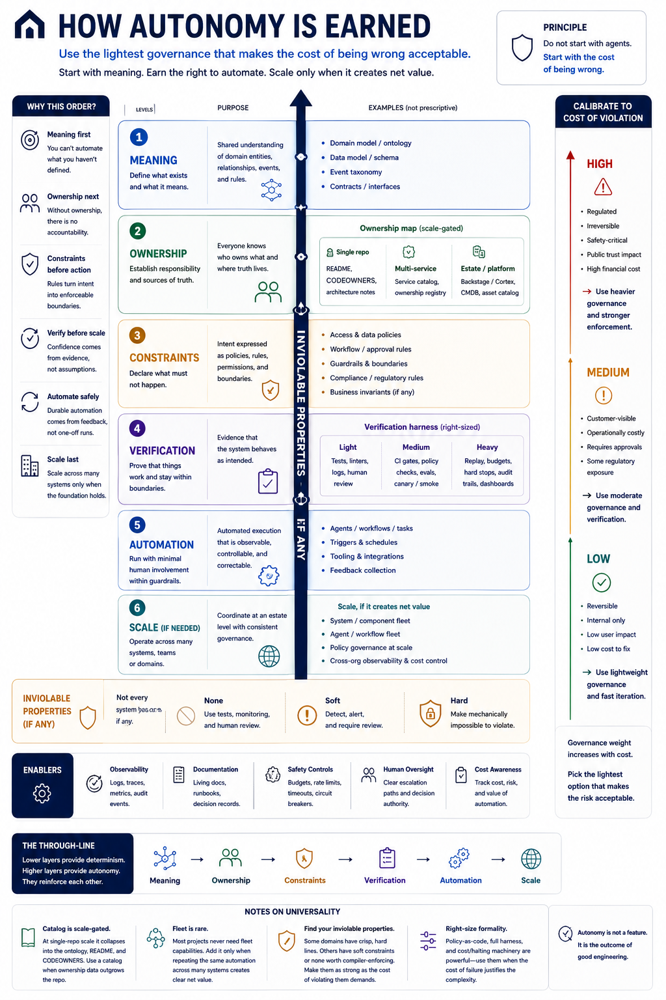
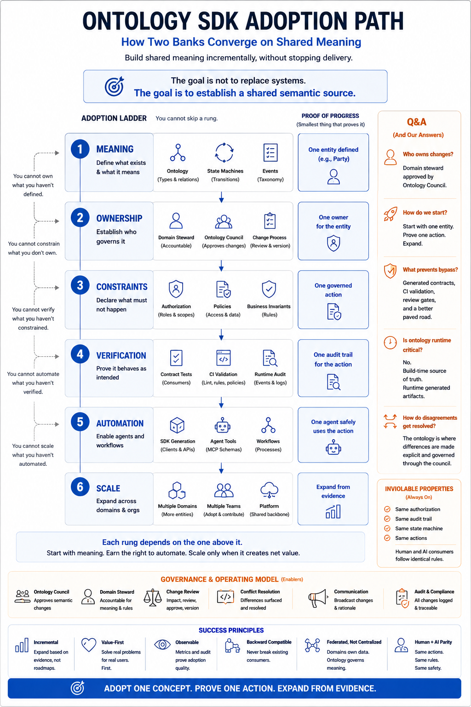
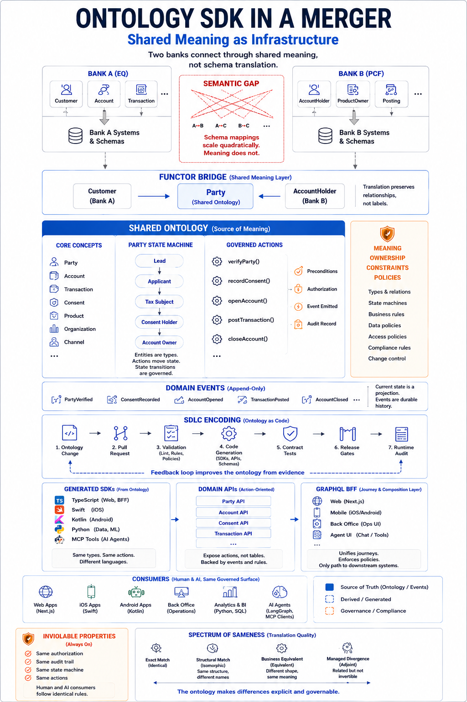
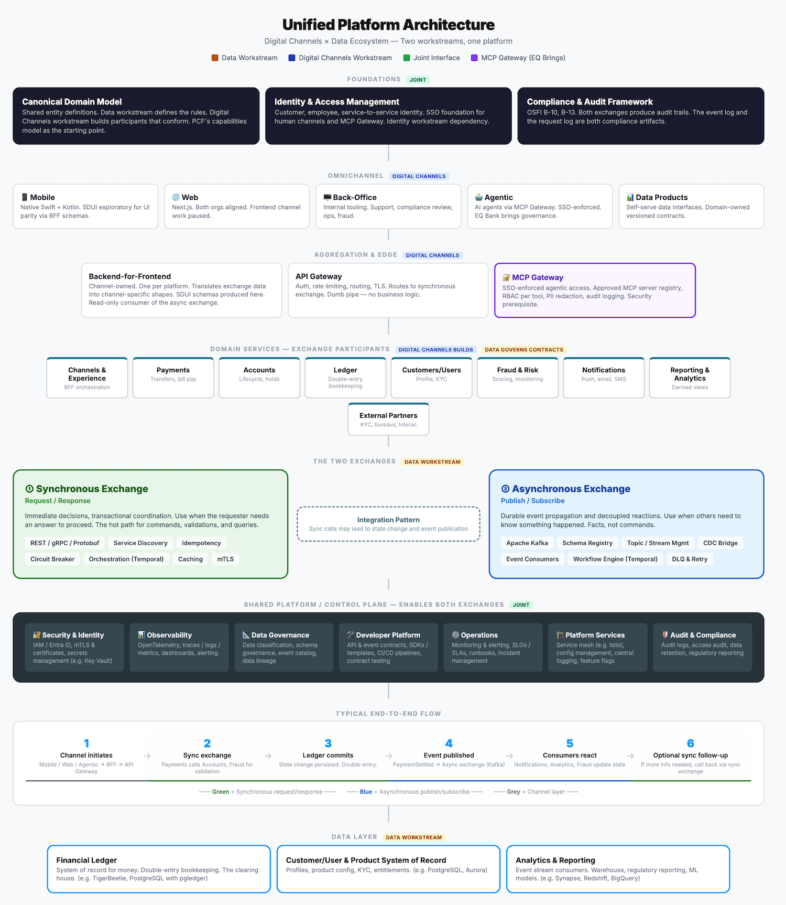

Agents show whether a company's foundations are ready. They need the same things any system needs before it can act on its own: shared definitions, clear ownership, constraints, and a way to verify what happened. Those come in that order, and automation comes after them. In a regulated firm, the way to find out where you stand is to build something small enough to observe, and to ask one question of it: what level of governance makes the cost of being wrong acceptable?

I've watched this play out from two directions this year: a merger between two engineering organizations, and a small team building an agentic software factory (a chain of agents that plan, write, review and deploy code) inside a regulated financial institution. Both kept raising the same questions about ownership, authorization, audit and source of truth. This post brings together what I wrote about each earlier in the year.

## Pressure shows the foundations

We've been working through a merger: two engineering organizations, two toolchains, and more than one answer to questions that used to feel obvious. Where does customer data live, who owns it, and which system gets the final say? The integration work itself is the easier part. The harder part is discovering which decisions made years ago are still holding, and which were never really decisions at all, just the path of least resistance repeated often enough that it started to look like architecture.

A merger works as a stress test. It reveals foundations that stayed invisible while everything lived inside one environment, and it tests three of them.

**Shared meaning.** Some teams call this a canonical domain model; others call it an ontology. Either way, it is a shared understanding of what the business is. A schema can tell you that a customer has a name, an address and an identifier. An ontology tells you what a customer is, which states it can move through, which relationships it can take part in, and which actions are allowed at each stage. The distinction sounds academic until two organizations try to merge their systems and discover they have used the same word for different things. When the definitions exist, a merger becomes the work of reconciling two implementations of the same ideas: hard, but tractable. When they don't, the disagreement is about meaning, and no amount of implementation settles it.

One pattern I keep seeing is what I think of as the Golden Source Myth: the belief that somewhere in the organization there is a single true representation of each business entity, waiting to be found. In practice there are several valid representations, each built for a different purpose. A customer in a CRM, a customer in a lending platform and a customer in a ledger serve different needs and carry different constraints. Shared meaning keeps them coherent; a single database can't. I wrote more recently about [who should own that shared meaning](/blog/2026/11/27/ai-agent-joins-your-company/) once agents depend on it.

**Audit.** In regulated environments, a write to a system is a business action with compliance implications. When systems are built around durable events and append-only history, audit comes almost for free, because the architecture already keeps the story of what happened. When they aren't, audit becomes a separate process layered on afterwards. That works, at the cost of complexity, manual effort and reliance on people remembering. The difference shows the moment someone asks how a system got to where it is now.

**Seams.** Seams are the boundaries that let you change a system: bounded contexts with explicit owners, event-driven interfaces, financial ledgers kept apart from operational workflows. The systems that come through a merger well are rarely the newest or the most elegant. They are the ones with places to cut when systems split, owners move or the organization changes. A surprising amount of architecture works only as long as nobody touches it.

## The layers, in order

The same three tests turn up when you ask what an agent needs before it can act safely. I used to think of governance and automation as opposing forces, one slowing work down and the other speeding it up. I now think they are the same work seen from different sides. The systems that can safely automate the most are usually the ones with the clearest definitions, ownership, constraints and verification.

At the bottom is meaning, the shared-meaning test above. Before a system can make decisions, the things inside it need shared definitions. Whether you call that a domain model, an ontology or a contract matters less than the outcome: everyone agrees what exists and how it relates to everything else.

Next comes ownership. Someone needs to know who owns what, where the source of truth lives, and who is accountable when something changes. At small scale this might be a repository, architecture notes and a CODEOWNERS file. At larger scale it becomes a catalogue. The implementation changes; the principle holds.

Then come constraints and verification, which is where audit belongs. Rules define what must not happen, and verification provides evidence that the system behaves as intended. The right level of formality depends on the cost of failure. Some systems need little more than tests and human review. Others justify policy-as-code, replay systems, audit trails and hard enforcement boundaries.

Only then does automation arrive. Agents consume the layers beneath them. An agent working inside clear definitions, constraints and verification behaves very differently from one working on hope and a prompt. If the domain model is unclear, the agent inherits the ambiguity; if ownership is fuzzy, it inherits the confusion; if audit is missing, it accelerates the problem.

Scale comes last, if it comes at all. Most projects will never need fleets of agents, and that's fine. The goal is safe, useful automation. Seams run through every layer: they are what let you change one layer without breaking the others.

## Evidence by building

Over the past year I've watched two approaches to AI adoption inside the same regulated institution. One started with governance: policies, controls, approval processes, risk reviews and discussion of what might go wrong. The concerns are legitimate. Being wrong can mean financial loss, harm to customers, compliance breaches and lost trust. But governance discussions often happen without a concrete system to govern, and it is hard to reason about controls, ownership and accountability in the abstract.

The other approach started with our R&D guild, a small team kept apart from production. Its job is to explore what becomes possible, feed what it learns back into how we work today, and make the gaps visible. It assembled an agentic software factory in a controlled environment. A ticket arrives; one agent writes an implementation plan, another writes the code, another reviews it, and another prepares deployment. People sit at the gates between stages, because in a regulated environment human review is part of the system design. The team is now preparing to trial the approach with a production engineering pod.

Building a small, observable system changed the governance conversation. Hypothetical risks became specific ones, and generic controls became targeted ones. The quality of the outcome also depended far less on the individual agents than on the structure around them: the more explicit the constraints became, the more reliable the workflow became.

Sequencing matters more than tooling. Most organizations can picture a target state. They struggle to reach it step by step while still delivering, which is why the adoption path below is about order, not technology.

## What moves for leaders

The most useful way I've found to start working with agents is to treat them like junior developers. You don't hand a junior developer a vague ticket and disappear, you don't merge their code without review, and you don't assume silence means progress. Give an agent a poorly defined problem and it will often produce something technically reasonable that misses the intent. The failure is one of translation, not competence.

The analogy breaks down at improvement. A junior developer improves through experience; an agent doesn't. When an agent's work gets better, it is usually because the system around it got better: richer context, sharper skills, clearer constraints, stronger verification, more explicit definitions of success. You develop the environment the agent works in, not the agent.

That raises a concern I think of as comprehension debt: producing work faster than you can understand, reproduce, debug or defend it. Who wrote the code matters less than who owns it, and ownership still sits with the engineer who reviews it. If output arrives faster than understanding, the bottleneck has moved to review, not gone away.

The same shift reaches engineering leadership. My Staff+ engineers spend their time building the harness: orchestration, governance boundaries, ontology-backed knowledge models, and the tooling that shapes what agents can see and do. My responsibility sits a layer higher: defining constraints, clarifying ownership, and making business rules explicit enough to survive contact with tooling. A constraint documented today becomes policy tomorrow. An architectural decision written clearly enough becomes guidance surfaced in the developer's editor at the moment it matters. Much of what looks like documentation turns out to be infrastructure in waiting.

Agents struggle in the places where the organization relied on shared understanding instead of shared definition. No amount of orchestration makes up for a constraint that never made it into the system. The work increasingly is to make the organization explicit enough that good judgment no longer depends on tribal knowledge.

## Before the pressure arrives

Foundations stay invisible until something applies pressure: growth, regulation, a reorganization, a merger, and now agents. Two questions do most of the work. Before you build, ask what level of governance makes the cost of being wrong acceptable. Before the pressure arrives, ask this: if you had to split this system in two tomorrow, where are the seams? If you can't answer that quickly, you may not have an architecture. You may have a history.

---

## Appendix

### Measuring the investment

Engineering isn't the only function relearning how to judge AI investment. Finance is too. The easiest metric is hours saved, and in my view it is the weakest. Time doesn't appear on a profit and loss statement unless it becomes something concrete: supporting more volume without proportional hiring, shortening delivery cycles, reducing operating cost, or creating new revenue. Until that conversion is explicit, the savings stay theoretical, and finance is right to discount them.

We already split investment between keeping the lights on, improving quality, building new capabilities, and making the engineering system itself more productive. AI cuts across those categories. Some investments raise the throughput of existing teams. Others make previously impractical work affordable. Others create strategic options whose value won't show for years. Those are different claims needing different evidence, and treating them as a single line called "AI" hides what we are learning.

### Target architecture

The diagram below shows the target state from the merger: two organizations converging on a shared ontology that defines meaning once and generates governed interfaces for applications, analytics and AI agents alike.

